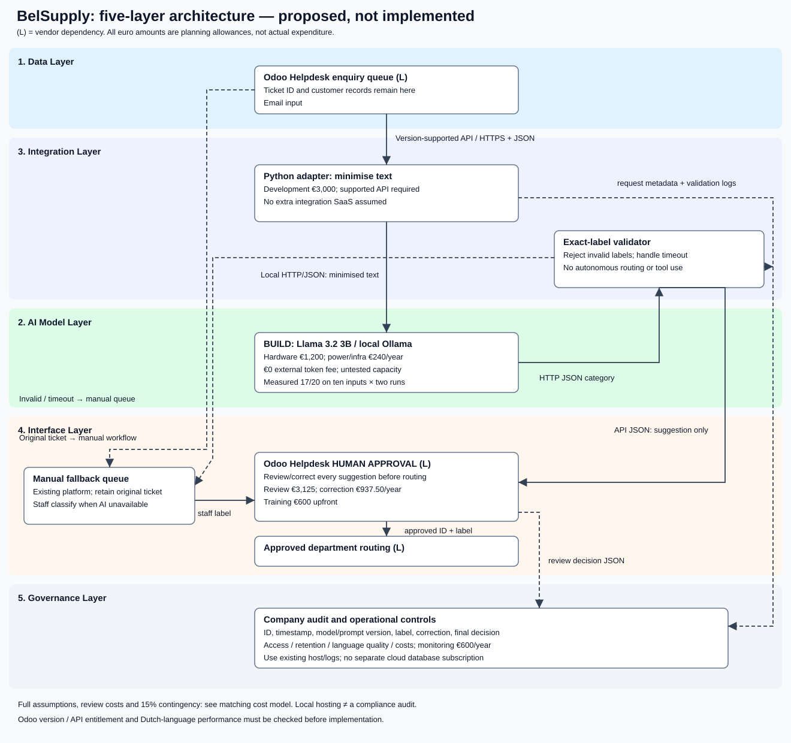

# BelSupply BV — Week 8 architecture evidence

Bentil Benoah Boakye · 4 ECTS · AI in ERP and Business Process Automation · Odoo

Hypothetical Ghent wholesale/e-commerce SME: 45 staff, 100 enquiries per working day, NL/FR/DE/EN, €15,000 first-year budget and three-month implementation window. This is an unimplemented design, not a deployment observation.

## Five decisions

**1. Data Layer.** Email enters Odoo Helpdesk; ticket IDs and customer records remain there. Middleware retrieves only necessary enquiry text over the installation's supported API, removes unnecessary identifiers and keeps a ticket correlation ID outside the model prompt. Incoming emails are untrusted customer-controlled data; no shipment, payment or contract database is supplied to the classifier.

**2. AI Model Layer.** Connect an existing open-weights model, Llama 3.2 3B, through local Ollama using the revised Week 8 prompt; no training or fine-tuning is proposed. The Build box returns only Order Status, Invoice/Payment, Return/Refund, Product Issue or Other. Measured success is 17/20 on ten synthetic enquiries twice; Dutch is not officially supported in the model page's language list, so a representative multilingual pilot is essential.

**3. Integration Layer.** Python middleware retrieves pending enquiries, minimises input, calls Ollama's local /api/chat HTTP/JSON endpoint and validates the returned label before writing a suggestion to Odoo. Choose an API supported by the installed Odoo version, with authenticated least-privilege access; confirm entitlement because external API access is plan-dependent. Timeouts, malformed labels and connection failures leave the original ticket in the manual queue, without an automatic retry in this evaluation or automatic routing in the design.

**4. Interface Layer.** Staff stay in Odoo, review the suggested label and approve or correct it before routing; nothing sends a customer reply, issues a refund or closes a ticket. The manual queue also accepts tickets without suggestions during outages, and staff receive training in overrides and valid-but-wrong outputs. Proposed per-ticket review is 15 seconds plus 30 extra seconds for errors, both unmeasured financial assumptions.

**5. Governance Layer.** Company-controlled audit records hold correlation ID, timestamp, prompt/model version, suggested category, reviewer correction and final decision; avoid copying whole email bodies unnecessarily. Define retention, access controls, secret handling and service logging, and monitor outcomes by category/language, availability and review workload. The internal assistive scope is provisionally minimal risk under the EU AI Act, subject to review of actual purpose/configuration; local hosting alone does not establish GDPR compliance.

## Sketch

Mermaid source: [belsupply-architecture.mmd](belsupply-architecture.mmd). `(L)` denotes vendor dependency. SVG and Mermaid show the same proposed flows, not implemented connections.

## Build integration questions

1. **What feeds it?** Minimized enquiry text from customer email in Odoo; customers and employees can influence that text. Treat embedded instructions as data and give the classifier no tools or direct routing rights.
2. **What uses its output?** Middleware validates an exact label and writes a suggestion to Odoo; an employee sees it before routing.
3. **What happens when wrong?** Reject invalid labels; require review for valid labels too. In Week 8 zero invalid formats occurred, yet case 7's double-payment enquiry was labelled Order Status twice and case 6's Dutch enquiry was wrong once: format validation alone catches none of those three semantic failures.
4. **What happens when unavailable?** Preserve ticket state and classify/rout manually in the existing queue. Do not block service on an AI response; alert the service owner through the existing interface and logs.
5. **Where is information stored?** Odoo stores tickets; approved company infrastructure stores minimal audit records. Model requests are transient by design, subject to verifying service logging, caches, backups and retention settings before deployment.

## Components and matching costs

| Component in sketch | Cost treatment in [cost model](belsupply-costs.md) |
|---|---|
| Email, Odoo Helpdesk / human interface `(L)` | Existing entitlement assumed; incremental upgrade unknown. €3,125/year review + €937.50 correction at launch, borne by BelSupply. |
| Odoo API and ticket schema `(L)` | Integration €3,000; confirm plan access before accepting estimate. |
| Python adapter, validation, manual fallback | Included in 60 development hours; no separate integration SaaS assumed. |
| Local Ollama / Build model | €1,200 hardware upfront; €240/year power allowance, not measured; €0 external token fee. |
| Company audit/monitoring controls | Included in €600/year maintenance and monitoring; uses same host, no separate cloud database subscription. |
| Staff review/override workflow | €600 training upfront, plus per-ticket review/correction above. |
| Risk allowance | 15% contingency across all specified first-year project costs. |

Odoo API/ticket fields remain lock-in points. The adapter preserves portable labels, prompts, test inputs and results; changing models still requires testing and approval. Do not promise a migration duration from the experiment. Evaluate deterministic rules and current Odoo features as alternatives before purchasing hardware; their quality and total cost have not been tested here.

Three-month proposal: month 1 baseline measurement, API/plan check, minimisation and prototype; month 2 larger multilingual held-out tests and review workflow; month 3 supervised pilot, staff training and rollback rehearsal. Sixty development hours is an assumption to validate against this work, not three months of full-time engineering.

**AI disclosure:** ChatGPT assisted the proposed architecture; Codex checked sources, linked the actual experiment, and created matching diagrams. No Odoo integration or production workflow has been implemented. See [source checks](source-checks.md).
