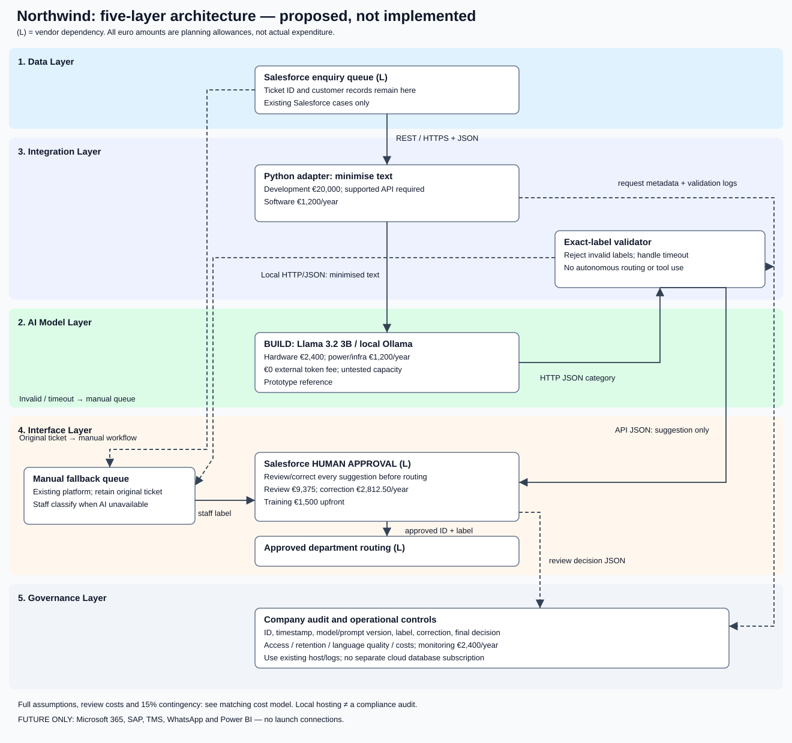

# Northwind Logistics — Week 8 individual catch-up

Bentil Benoah Boakye · 4 ECTS · 27 November 2026

## Absence disclosure

I missed the Week 8 class and completed this exercise individually as catch-up work. I did not participate in a team presentation, Q&A or peer critique, and no peer critique forms are claimed. The lecturer has not confirmed individual catch-up as an approved substitute for those activities.

## Company, constraints and use-case justification

Northwind Logistics NV is the composite Antwerp freight forwarder from the course case: 340 employees, €58 million revenue and 450 active clients. Its cap is €50,000 including implementation and first-year operation, with three months to implement, two internal developers and one data analyst. Existing systems are SAP S/4HANA, Salesforce, legacy TMS, Microsoft 365, Power BI and WhatsApp Business; NL/FR/DE/EN customer communication must be supported.

I propose AI-assisted classification and routing of customer enquiries already in Salesforce. Unstructured wording across languages makes this a plausible assistance task, but deterministic rules and available Salesforce AI should be evaluated before committing to a custom connector. Employees keep the final decision; this model does not answer shipment questions, retrieve shipment facts or make customer decisions.

**Launch scope is Salesforce only.** Microsoft 365, WhatsApp, SAP and TMS connections are postponed; Power BI is not a launch dependency. This keeps the implementation manageable and avoids a read-only SQL/TMS integration whose data this classification task does not need; TMS replacement remains out of scope. If shipment-status retrieval becomes the use case, the deferred systems, privacy boundaries, costs and feasibility need a new design.

## Five-layer decisions

**1. Data Layer.** Retrieve existing Salesforce enquiry text through its REST API, minimising identifiers before inference; keep pricing, contracts and shipment records in their original approved systems. TMS has no public API but is not connected, and no live SQL access or data export is assumed at launch. Only local company-hosted inference is proposed; cross-border cloud transfer is not introduced by this design, without claiming a network audit.

**2. AI Model Layer.** Connect Llama 3.2 3B through local Ollama using prompting rather than fine-tuning; a dedicated server is a €2,400 planning allowance, not a tested specification. The BelSupply/Odoo classifier prototype is a portable experimental reference, not a Northwind validation: its five labels must be reviewed for logistics coverage and a new representative expected-answer set created. The model lists English, French and German support but not Dutch; all four languages require evaluation, and €0 external token charges do not mean free inference.

**3. Integration Layer.** Python middleware connects Salesforce REST to Ollama HTTP/JSON, validates category labels, records failures and writes a suggestion only. Check the Salesforce edition, API-enabled service user and limits before treating existing licensing as sufficient. Connection failures or invalid labels preserve the original manual queue; Microsoft 365 and the other deferred systems have no active arrows or incremental launch integration costs.

**4. Interface Layer.** Staff see suggested categories in Salesforce, approve or override them, then route the enquiry. Training covers valid-but-wrong labels and manual operation during an outage; no automatic customer responses are enabled. Launch monitoring uses middleware logs, not a new Power BI connector or Teams interface.

**5. Governance Layer.** Record correlation IDs, model/prompt version, proposed label, corrections and approved routing; restrict access and define retention and backup/logging controls. Monitor errors by language/category, API failures, human workload and costs on approved EU infrastructure. Internal assistive classification is provisionally minimal risk under the EU AI Act; purpose and final configuration still need verification and local hosting does not alone establish GDPR compliance.

## Architecture

[Mermaid source](northwind-architecture.mmd). `(L)` marks Salesforce API/ticket-schema dependency. The local classifier box is the proposed Build reference; nothing here has been deployed. Microsoft 365 appears only as an explicitly disconnected future extension.

| Cost-bearing component | Matching budget treatment |
|---|---|
| Salesforce-only adapter, validation, review UI and manual fallback | €20,000 development; existing Salesforce/API entitlement conditional, upgrade excluded until quoted |
| Local Ollama model host | €2,400 hardware; €1,200/year infrastructure/power allowance; €0 external inference tokens |
| Middleware/software | €1,200/year allowance, not a verified software subscription |
| Audit logs, monitoring and maintenance | €2,400/year, includes assumed analyst support; no separate Power BI licence or connector |
| Staff approval and correction | €9,375/year review + €2,812.50 correction at launch; Northwind bears both |
| Training | €1,500 upfront |
| Contingency | 15% across stated project costs |
| Deferred Microsoft 365 / SAP / TMS / WhatsApp / Power BI connections | No incremental launch cost or active data flow; existing sunk company licences excluded |

## First-year budget and cost at scale

Full arithmetic, Month 1/6/12 projections, annual growth, ROI, payback and cost per correctly handled query: [northwind-costs.md](northwind-costs.md). Reproduction: [financial-checks.json](financial-checks.json) and [check_financials.py](check_financials.py).

At constant 300 daily enquiries, first-year cost is **€47,020.63**, leaving **€2,979.37**. Fixed first-year costs are **€28,700**, of which €23,900 is upfront and €4,800 recurring; monthly allocated totals at 300/600/900 daily enquiries are **€3,918.39 / €5,086.35 / €6,254.32**. These are allocated first-year costs, not monthly bills.

With an explicit added schedule of 300/day in months 1–5, 600/day in months 6–11 and 900/day in month 12, first-year cost rises to **€56,364.38**, exceeding the cap by **€6,364.38**. Capacity, additional licences, remaining downstream error losses and VAT could worsen the position. A rollout with that growth requires scope reduction, resource changes or revised approval; the constant-volume budget cannot stand in for it.

Implementation proposal: month 1 verify entitlements/data access, baseline rules and representative tests; month 2 build the adapter and supervised review; month 3 multilingual acceptance testing, training and rollback rehearsal. Two developers are part-time: at an illustrative €50/hour, €20,000 buys 400 total hours, not two full-time developers for three months. This work has not been timed or performed.

## Five board-defense answers

### 1. Why not Salesforce Einstein or Microsoft Copilot?

I would first check included Salesforce capabilities and price/quality on this exact task; I have not established that a local alternative offers better value. Launch uses only Salesforce, and Microsoft 365 is postponed, so a Copilot/Graph workflow is not silently included. The €20,000 custom development allowance is only justified if a pilot beats simpler rules or an entitled built-in option after review costs.

**The first-year number is against me.** At a constant 300 enquiries/day, the [cost model](northwind-costs.md) gives a first-year cost of €47,020.63 against €37,500 of manual categorisation time. That is **−€9,520.63, a first-year ROI of −20.25%**. Base payback only comes after 13.98 operating months, or 18.36 months with the 15% reserve, so this design does not pay for itself in year 1. Under the added growth schedule ROI becomes +10.89%, but that scenario breaks the €50,000 cap (question 2). Even the €37,500 is weak: it rests on a 60-second manual-handling assumption that I added for sensitivity and never measured at Northwind. My honest board answer is that I cannot ask for a year-1 return. I would ask for a smaller, measured pilot and compare it with rules and included Salesforce features before spending the full €20,000.

### 2. What happens when volume triples?

The monthly first-year allocation increases from €3,918.39 at 300/day to €6,254.32 at 900/day, while external token charges stay zero; review and correction grow, fixed allowances do not automatically triple. At 900/day, the time assumptions imply 4.875 staff hours/day for review plus correction, and server capacity remains untested. The explicit growing-year schedule breaches the cap by €6,364.38, so I would not approve it under the unchanged €50,000 limit.

### 3. How quickly can you switch providers?

I would allocate two weeks as an initial planning window for replacement-model testing and adapter changes, not promise a measured migration duration. The Week 7 comparison showed an 80 percentage-point strict-match gap from the historical cloud baseline, so preserving prompts and JSON alone is insufficient. Keep manual Salesforce work operational until a replacement passes a representative multilingual set; the Salesforce dependency remains.

### 4. Can it support all four languages?

NL/FR/DE/EN is a requirement, not a demonstrated capability: Dutch is absent from the model's official supported-language list. The Odoo test has only one Dutch enquiry, repeated twice, and no French/German enquiries; it cannot establish per-language Northwind quality. I would require held-out tests and measure token lengths, errors and staff review time separately before launch.

### 5. What is the biggest overlooked risk?

Valid-but-wrong labels can bypass format checks: the Week 8 classifier returned three incorrect labels despite zero format failures. A misrouted urgent shipment or payment enquiry could cause service delays and downstream financial loss beyond the €0.25 assumed correction cost. Require approval before routing, allow override/manual fallback, and measure missed-review failures; no perfect human accuracy or worst-case loss estimate is claimed.

## Budget sensitivity

Neither budget changes the negative first-year ROI (−20.25%) at launch volume; more money buys scope, not a better return. At €25,000, the constant-launch estimate is unaffordable: restrict to a smaller supervised rules-versus-AI pilot and re-cost rather than claim the same system fits. At €100,000, the €56,364.38 growth scenario has nominal headroom, but extra funding does not establish multilingual accuracy, capacity or justify activating every deferred connection. Neither is a procurement quote.

## AI assistance and limits

ChatGPT assisted the supplied architecture, estimates and defense preparation; Codex verified arithmetic and sources and created matching diagrams. The Northwind design has not been implemented or tested. These are written individual catch-up answers, not evidence that I presented them to a board, participated in a team or exchanged critiques. [Source checks](source-checks.md).
