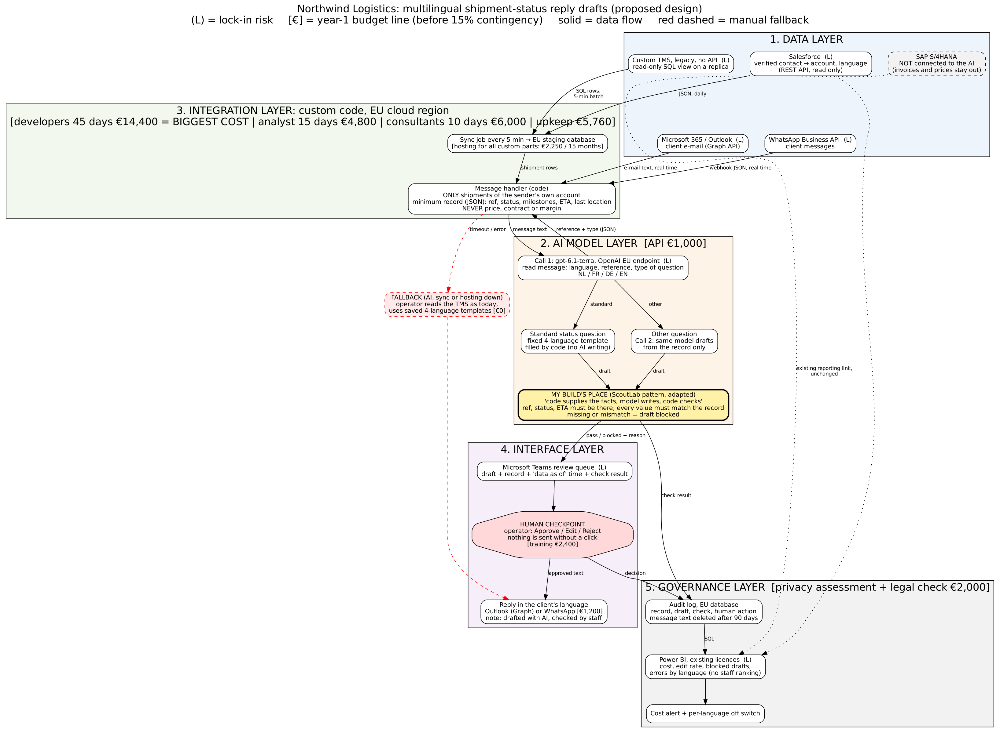

# Week 8 Design Defense: Northwind Logistics

**Student:** Gaetan Werbrouck | **Beat:** How football clubs use data to find undervalued players | **Date:** 27 November 2026

**Individual submission:** I was not in the Week 8 class and was not in a team, so this is not a team set. I prepared it with AI help. I have no peer critique forms ([explanation](critique-forms.md)).

Northwind Logistics NV is the course's composite company. This is a proposed design. Nothing in it has been built or tested at Northwind, and every Northwind volume, time and rate below is my assumption.

## 1. Use case and why this one

**Use case:** draft replies to "where is my shipment?" questions from e-mail and WhatsApp in Dutch, French, German or English. An operator approves every reply before it is sent.

**Why:** the question repeats, the answer already exists as a record in the TMS, an operator can check a draft against that record in about a minute, and it needs no write access to any system. What I have not proven is the volume and the time it takes today. I assume 80 questions a day in month 1, 200 in month 6, 600 in month 12, and 6 minutes per manual reply. Week 1 of the project has to measure both. The design stops being worth building if the net time saved falls below about 1.3 minutes per question (2.7 if only half of the freed time is put to use).

| Rejected | Reason |
|---|---|
| Route optimisation and carrier assignment | Mainly an optimisation problem, not a language-model job. It would also need to write back into the legacy TMS. |
| Customs document processing | A wrong code or value can cause fines and held cargo. I cannot test that safely with this team in 3 months. |
| Demand or capacity forecasting | I have no evidence the historical data is clean enough, and the value is slow to prove. |
| A client-facing chatbot with no human check | It would send unreviewed shipment facts to clients. |

## 2. Five-layer design decisions

**1. Data.** A sync job reads a read-only SQL view on a replica of the TMS every 5 minutes into a staging database in the EU; Salesforce supplies the verified contact, account and preferred language, and Microsoft Graph and the WhatsApp Business API supply incoming messages. The view exposes only reference, account ID, status, milestones, ETA and last location, so SAP is not connected and prices, contracts and margins never enter the AI path.

**2. AI model.** I connect to one commercial API, gpt-6.1-terra on OpenAI's EU endpoint, with prompting only: one call reads the message (language, reference, question type) and a second call writes a draft only for non-standard questions, while standard status replies use fixed four-language templates filled by code. I budget at the higher gpt-5.6-terra price plus the 10% EU uplift (about €0.011 per question), and keep the model name, endpoint and prompt in configuration so a second provider can be tested on the same test set; EU residency needs approval, so if it is not confirmed by week 2, Azure OpenAI in an EU data zone is the alternative to price and test.

**3. Integration.** Small custom services in an EU cloud region handle the sync, the message handler and the check, with real-time handling of messages and a 5-minute batch for shipment data. The handler only returns shipments that belong to the sender's own verified account, and on any timeout or error the operator works as today with saved templates, because no step writes to SAP, Salesforce or the TMS.

**4. Interface.** Drafts appear in a Microsoft Teams review queue next to the source record, its "data as of" time and the check result, and an operator chooses Approve, Edit or Reject. About 20 operators (assumption) get 3 hours of training, including exercises with deliberately wrong drafts so that approving does not become a reflex.

**5. Governance.** Every record, draft, check result and human action is logged in the EU, message text is deleted after 90 days, and Power BI shows cost, edit rate, blocked drafts and errors by language, with no ranking of individual staff. My working classification is that this use is not listed in Annex III of the EU AI Act and is low or limited risk; a legal check and a privacy impact assessment come before go-live, each draft is human-approved, and the reply says it was drafted with AI.

## 3. Architecture sketch

Every system in the profile appears: **TMS, Salesforce, Microsoft 365, WhatsApp** and **Power BI** are used. **SAP** is shown as deliberately not connected to the AI (its existing Power BI link stays as it is).

### Lock-in markers

| (L) component | Level | Why | Way out |
|---|---|---|---|
| TMS database schema | **High** | No API, so my SQL view depends on 8-year-old tables that can change | One view is the only contact point; test it after every TMS change; manual path stays |
| Model provider | Medium-low | Prompts and behaviour differ per model, even with similar APIs | Config-based endpoint; rerun the four-language test set; I budget 2 to 5 developer days, untested |
| Salesforce | Low for this project | Northwind already depends on it; I only read three fields | Export contact language and account mapping |
| Microsoft 365 and Teams | Medium | Mail access and the review queue use Microsoft formats | Queue logic stays in my own database; a plain web page could replace the Teams card |
| WhatsApp Business API | **High** | Meta sets the price and the rules, and there is no substitute for the same channel | E-mail path works without it |
| Power BI | Low | Reporting only, existing licences assumed | The audit log is a normal database table |

## 4. Where my Build sits

My Build is **ScoutLab**, a football scouting app. It does not belong in a freight company, and I won't pretend its code or its scores transfer. What I place in the sketch is the **pattern** from its optional AI summary, adapted: code supplies the facts, the model writes, and code checks the result. It is the yellow box. The Northwind checker would be new code and has never been tested. Unlike ScoutLab today, it **blocks** a failed draft. ScoutLab shows the note with a warning.

ScoutLab's evidence, on football data only: llama3.2:3b passed **4 of 20** player notes in the Week 7 run, and Claude Sonnet 5.5 in the claude.ai chat passed **19 of 20** (not an API test). With temperature 0 the two llama runs gave the same pass or fail for each player, so that is closer to 10 independent results than 20. In Week 8 I let code calculate the strongest and weakest metric: llama's checker score went from 4 to **20 of 20** on the same test. That is not a quality score. Stat values or percentiles appeared in 18 of 20 summaries before and **0 of 20** after, the checker did not notice, and some conclusions are still unsupported. Claude was not tested on the new prompt. These rates say nothing about shipment replies.

### How ScoutLab's measured failures constrain this design

These failures were measured on football notes (llama3.2:3b, Week 7), so they are warnings for Northwind, not Northwind error rates.

| What failed | Design rule it leads to |
|---|---|
| Wrong strongest (10 of 20) and weakest (14 of 20) metric, although the numbers were in the prompt | The model does not do what code can do: code selects the shipment record and fills standard replies. The model only reads messages and drafts non-standard replies |
| Exact output format followed in 0 of 20 notes | Code does not trust the model's layout: call 1 must return JSON that passes validation, otherwise the message goes to manual handling |
| After the Week 8 change the checker passed 20 of 20 notes while none of the summaries quoted a stat value | Checking for wrong values is not enough: a draft must also **contain** the required fields (reference, status and, where the record has one, the ETA), or it is blocked |
| Wrong wording around correct numbers passes the checker | A passed check is not an approval: a person reviews every draft next to the source record, and training includes drafts with a wrong meaning |

### The five questions: the box in the Northwind sketch

1. **What feeds it?** A draft plus the minimum shipment record. TMS users and carriers influence the record, and the client influences the message. A message could contain instructions aimed at the model, so the model gets no tools, the code picks which records are allowed, and a human sends.
2. **What consumes it?** The Teams queue. An operator sees every draft before any client does.
3. **What happens when it is wrong?** It should catch a reference, date, time or place that differs from the record, and a draft that leaves out a required field. It will pass a wrong meaning built from correct values (for example "has arrived" where the record says "expected"), a bad translation, a missing caveat, and any error already in the TMS. ScoutLab showed this gap: prose calling a 23rd-percentile figure "above the average" cannot be caught by its checker.
4. **What happens when it is unavailable?** No draft is released as checked. The operator replies manually from the TMS.
5. **Where does it store what it sees?** In the EU audit log. The full message text is deleted after 90 days.

### The five questions: ScoutLab as it exists today

1. **What feeds it?** By default a Premier League 2023/24 CSV (339 rows) loaded from a third party's public GitHub link, or a CSV the user uploads. Whoever controls that repository can change or remove the data, and its licence is unclear.
2. **What consumes it?** A person reads the profile and optional AI note on screen. The shortlist CSV export is table data, not the AI note.
3. **What happens when it is wrong?** In the Week 7 llama run the failures were wrong strongest metric (10) and wrong weakest metric (14), counted over 20 notes; one note can fail both. With the Week 8 change both fell to 0, but the summaries stopped quoting stat values. Invented numbers and flagged unsupported claims were 0 in that run, which does not prove they cannot happen. Wrong wording around correct numbers passes. My Week 2 test-set labels include F2 (fabricated); the 15 ScoutLab UI cases reported 0 F2, once, and F6 (consistency) was not tested.
4. **What happens when it is unavailable?** If the model endpoint fails, the app shows an error and the tables still work. If the dataset link fails once the 6-hour cache is gone, the default dataset cannot load; uploading a CSV is the way round.
5. **Where does it store what it sees?** The shortlist lives in the browser session and the dataset in a temporary cache; the app code keeps no log of AI notes. With a local Ollama model the prompt stays on the laptop. With a cloud endpoint the player's data goes to that provider.

## 5. Cost model

**Price sources:** [course AI Pricing Reference](https://advanced-ai-in-business.vercel.app/resources/ai-pricing-reference.md), snapshot **7 September 2026**: gpt-5.6-terra $2 input / $12 output per 1M tokens, $1 = €0.92. [OpenAI's GPT-6.1 Terra announcement](https://openai.com/index/introducing-gpt-6-1-terra/), newer than that snapshot, checked **27 November 2026**: $1 / $5. [OpenAI API pricing](https://developers.openai.com/api/docs/pricing), checked 27 November 2026: +10% for EU regional processing on eligible newer models. I apply the uplift to both prices as an assumption.

**Token assumptions (per question, both calls together):** 1,500 input and 300 output tokens in English, multiplied by 1.45 for other languages (the top of my Week 1 English-to-Dutch measurements of +12.8% to +45.9%; French and German were not measured), plus 15% for retries. That is 2,175 input and 435 output tokens before retries.

**API cost, year 1:** 70,770 questions × (2,175 × $2.20 + 435 × $13.20) ÷ 1,000,000 × 1.15 × 0.92 = **€788** at the budget price (€358 at the GPT-6.1 Terra price). The 70,770 comes from a monthly ramp of 80, 100, 120, 140, 170, 200, 260, 320, 390, 460, 530 and 600 questions a day, 21 working days a month (252 a year; the course template's 250 gives almost the same result). The budget line is €1,000 to cover development testing.

| Budget line (matches the sketch) | Assumption | € |
|---|---|---:|
| Developers, build | 45 days in total × €320 | 14,400 |
| Data analyst (SQL view, test set) | 15 days × €320 | 4,800 |
| Consulting team | 10 days × €600 | 6,000 |
| Upkeep after go-live | 12 months × 1.5 days × €320 | 5,760 |
| EU hosting: sync, staging, handler, check, log, monitoring | 15 months × €150 | 2,250 |
| AI API | shown above, rounded up | 1,000 |
| WhatsApp messages | rounded up from €1,177 | 1,200 |
| Training and change | 20 users × 3 hours × €40 | 2,400 |
| Privacy assessment and legal check | estimate | 2,000 |
| Microsoft 365, Teams, Salesforce, Power BI | existing licences assumed sufficient | 0 |
| **Subtotal** | | **39,810** |
| Contingency 15% | | 5,972 |
| **Total** | | **45,782** |
| Headroom under €50,000 | | 4,218 |

- **The biggest risk to this budget is developer time, not tokens.** Two developers for 3 months is about 126 working days. I budget 45 (about 36% of their time). Costing all 126 days gives **€75,590**, which does not fit. The plan only works if the build really takes about 45 days.
- If management treats internal salaries as already paid (developers, analyst, upkeep), new spending drops to about €17,078 including contingency. I show the fuller figure because that time is not free.
- WhatsApp: I assume half the questions arrive there, with one reply each, 1,000 free service messages a month on one number, then €0.05 each. This is a rounded-up planning rate based on a [third-party figure of about €0.0456 for Germany](https://chatarmin.com/en/blog/whatsapp-business-costs), checked 27 November 2026. [Meta's pricing page](https://developers.facebook.com/documentation/business-messaging/whatsapp/pricing) says rates vary by market. Northwind would likely pay much of this without AI too.

### Scale (full tables in `cost-at-scale.md`)

| | Month 1 | Month 6 | Month 12 |
|---|---:|---:|---:|
| Questions a day (at most 2 model calls each) | 80 | 200 | 600 |
| Monthly token cost | €19 | €47 | €140 |
| Monthly total incl. errors (15% need correction) | €1,741 | €3,462 | €9,225 |
| Incl. errors and operator review time | €2,861 | €6,262 | €17,625 |
| Total cost per correctly handled question, incl. review | €1.71 | €1.50 | €1.41 |

These exclude the one-off build.

### ROI and payback (scenario, not measured)

Manual: 6 minutes × €40 an hour = €4.00 a question, **€283,080** for 70,770 questions. With AI: 1 minute of review on each question, plus 4 minutes of correction on the share that needs it, plus 0.5% of replies with an error that slips through at €50 each.

| Share needing correction | 15% (base) | 30% | 60% |
|---|---:|---:|---:|
| Value of time saved | €207,592 | €179,284 | €122,668 |
| Minus escaped errors | €17,692 | €17,692 | €17,692 |
| Minus full year-1 budget | €45,782 | €45,782 | €45,782 |
| **Net, year 1** | **€144,118** | **€115,810** | **€59,194** |
| Payback, month after go-live | 7 | 7 | 9 |

This is **capacity value, not cash**. Nobody's salary disappears because replies get faster. If only half of the freed time is put to good use, the base case net falls to about €40,322. The figures also lean on a volume ramp I invented: at 80 a day all year the case is far weaker.

## 6. Defense checklist

**Q1. Why not just use Salesforce Einstein or Microsoft Copilot?** Language is not the reason: [Einstein Service Replies for e-mail supports all four](https://help.salesforce.com/s/articleView?id=reply_recs_service_emails_console.htm&language=en_US&type=5) and drafts from knowledge articles, but our shipment status sits in a TMS with no API, so the data pipeline still has to be built, and the listed [Agentforce per-user add-on at $125 a month](https://www.salesforce.com/agentforce/pricing/) would be about €27,600 a year for 20 users. Copilot Studio with an on-premises data gateway is the serious alternative ([$200 a month per 25,000 credits](https://www.microsoft.com/licensing/guidance/microsoft-copilot-studio)), so in weeks 1 and 2 I would spend up to 5 days testing it on the same four-language cases, and switch if it meets the same error gate with control over which fields are sent.

**Q2. What does this cost at scale, and at 3x growth?** Going from month 6 to month 12 is 3× the volume (200 to 600 a day), and the monthly total including errors goes from €3,462 to €9,225, of which tokens are only €140. At 10,000 questions a day, tokens are about €2,339 a month but one-minute reviews need 3,500 hours a month (about 25 full-time people at 140 hours), so human review breaks first and the design would have to be reassessed, not just paid for.

**Q3. What if OpenAI raises prices or shuts down?** A tripled token price takes year-1 API cost from €788 to €2,365, which is over the €1,000 line but covered by the €4,218 headroom. For a shutdown, operators fall back to manual replies the same day while we point the configuration at a second provider and rerun the test set; my 2 to 5 developer-day estimate is not proven.

**Q4. How are Dutch, French and German handled, and what is the accuracy difference?** I do not know the accuracy difference, because I have not tested it; my only language measurement is tokens (+12.8% to +45.9% from English to Dutch), which is cost, not quality. Each language gets 50 anonymised real messages checked by a fluent speaker, and goes live only with at least 49 of 50 correct on reference and question type and 0 wrong facts reaching the review queue unflagged; a small sample like that cannot prove a low error rate, so monitoring continues after launch.

**Q5. What is the risk we're not seeing?** The worst one is client A receiving client B's shipment data, for example when someone quotes another company's reference, so the code, not the model, restricts records to the sender's verified account and we test that with deliberate attacks before go-live. The quieter ones are operators approving without reading, and stale data after a failed 5-minute sync: we measure approvals with no edits against planted wrong drafts in training, show the "data as of" time, and block drafts when the data is more than 15 minutes old.

**Bonus: €100,000?** I would not buy a bigger model: I would add about €6,000 for a larger four-language evaluation, €9,600 for 30 more developer days, €8,000 for TMS specialist work on safer change capture, €3,000 for a tested second provider and €5,000 for a security test, about €31,600 plus contingency, and leave the rest unspent until real volume is known.

**Bonus: €25,000?** I would drop WhatsApp and AI-written replies, keeping e-mail with AI message reading plus code-filled templates in four languages: 25 developer days €8,000, 8 analyst days €2,560, 4 consulting days €2,400, upkeep €2,880, hosting €1,500, API €300, training €1,200, legal €2,000 = €20,840, or **€23,966** with contingency. It is a much tighter build and I would call it a pilot.
