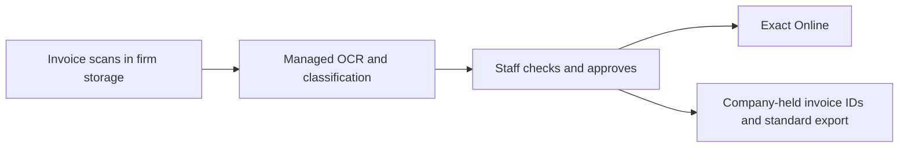

# Week 7 — Architecture and exit costs

Kiril Boyakov · Lock-in detection · 4 ECTS

## Warm-up

I would pick the portable interfaces if this were a system the startup expected to keep. I would accept the initial integration delay to keep data and model changes manageable. For a short trial, I would consider the single suite, provided we kept independent copies of the inputs and could stop the trial without migrating production data.

## OmniRetail diagnosis

| Dependency | Decision that created it | Prevention and cost at the time |
|---|---|---|
| Chat | Conversation logs live in the vendor's schema. | Write a JSON copy as each conversation closes. Budget for a mapper and restore test. |
| Recommendations | Fine-tuned model exists on vendor infrastructure. | Keep training data and evaluation cases independently. Budget for retraining and comparative evaluation. |
| Search | Embeddings use the vendor model and database. | Keep canonical product text and IDs in company storage. Budget for a second index and re-embedding trial. |
| Content | Prompts live in the vendor workflow builder. | Version prompts in Git. Budget for a small runner and tests. |
| Fraud | Training data, model and inference are bundled. | Retain labelled data and document the feature pipeline. Budget for separate governance and validation. |
| Analytics | Reports depend on vendor warehouse and BI format. | Keep standard extracts and independently document metrics. Budget for export jobs and reconciliation. |
| Interface | Applications parse the vendor response directly. | Translate responses at one boundary and test that boundary. Budget for adapter work up front. |

The course case estimates €15,000 for the shared prevention package and €400,000 for migration. The prevention items above are work categories within that approach. Separate prices were not provided. Fraud looks hardest to move because a replacement requires reconstructing the training and inference workflow and validating consequential decisions. The case does not allocate the €400,000 across components.

## GhentAccounting — Buy

1. Competitive advantage? The firm differentiates through accounting service. Invoice OCR is an intake task.
2. Commodity solution? Yes, subject to proving extraction and classification on Dutch, French and English invoice samples and checking the Exact Online integration. Buy is the first clear candidate.
3. Multiple capabilities unavailable from a single vendor? The stated needs are closely related. Ask a package to demonstrate both OCR and classification.
4. Major near-term change? The case supplies a two-month deadline and no evidence of rapidly changing requirements. Require a renewal and exit review.
5. Engineering capacity? Zero in-house engineers. A subscription within the €2,000–€5,000 monthly budget is feasible if implementation and service are included.

Provisional scores apply to the proposed architecture. Verify contractual evidence before signing.

| Dimension | Risk / 3 | Case evidence and procurement condition |
|---|---:|---|
| Data portability | 1 | Keep original scans and reviewed extraction rows in firm storage. Make a bulk CSV or JSON export a purchase condition. |
| API stability | 2 | Exact Online has an API in the case. The proposed connector's compatibility and notice period remain unconfirmed. |
| Pricing control | 2 | The budget is €2,000–€5,000 per month. Ask for per-invoice rates, volume bands and renewal notice. |
| Feature dependency | 2 | Vendor OCR and classification can be replaced in principle. A new vendor must pass the three-language invoice checks and reproduce field mappings. |
| Migration cost | 2 | Zero in-house engineers means using an implementation partner for import, mapping and validation. |

Total 9/15, provisional. Moderate exposure is acceptable if the firm can retain the books, originals and review records and can exit within its budget. OmniRetail would have to replace multiple interdependent systems. FlandersBio has a stronger reason to control a specialized workflow.

Illustrative exit budget, subject to quotations. Export and reconcile 8 staff hours × €40 = €320. Configure the replacement and map Exact fields 20 partner hours × €100 = €2,000. Validate multilingual invoices 12 staff hours × €40 = €480. Allow €2,000 for one month of overlap at the lower end of the stated budget. Total 40 hours and €4,800 at that overlap rate, or €7,800 if overlap costs €5,000. Run both on a representative sample before cutover. Any change in OCR quality remains to be measured.

## EuroRoute Forwarding — Gemini pilot scorecard

Architecture under review is the existing freight classification prototype. The prompt and test set live in GitHub. Hoppscotch sent the text to Gemini in Week 6. The example returned the transport mode, evidence and reason. Production processing and pricing remain outside the prototype.

| Dimension | Risk / 3 | Specific evidence |
|---|---:|---|
| Data portability | 0 | Prompt, ten cases and logged evidence are already retained as Markdown and JSON in the student repository. The prototype can reproduce these artifacts without requesting a vendor export. Broader production logging/export requirements would need separate review. |
| API stability | 2 | The request used a latest alias and the returned model was Gemini 3.5 Flash-Lite. Google publishes a retirement schedule and says it announces exact shutdown dates in advance. The checked page gives no universal minimum notice. The Week 6 404 also showed endpoint availability can interrupt the workflow. |
| Pricing control | 2 | The Week 6 measurement used public per-token list rates. Google publishes changes by model on its pricing page. No fixed rate or negotiated notice is documented for the prototype. |
| Feature dependency | 1 | The task uses plain text and three application-defined fields. The request and response envelopes and usage metadata are Gemini-specific. A replacement must preserve the three fields and equivalent behaviour on ambiguous descriptions. |
| Migration cost | 1 | The input, expected labels and prompt can be replayed. An alternative runner, output validation and regression checks are still required. See the estimate below. |

Total 6/15 for this prototype. Google’s published terms apply its paid-service data-use rules to users in the EEA even for unpaid quota. Under those rules Google says it does not use prompts and responses to improve its products, and may log them for a limited period for purposes including abuse detection. Confirm project configuration and applicable terms before processing real customer records.

Migration estimate for the prototype. Adapter and configuration 4 hours, validation and replay 3 hours, failure review and human fallback 3 hours, cutover and rollback check 2 hours. Total **12 hours × €40 = €480** at the Week 6 planning labour rate. Production integration, hardware and ongoing maintenance require their own estimates. The performance delta is pending the controlled comparison.

The working recommendation is to connect the classifier through a small interface the team controls, provided it beats a structured form or simple rules on total handling time. Keep the application’s three output fields stable and let the adapter translate each model’s envelope. MCP could help if we later connect tools across systems. It would not make model outputs, data exports or contracts interchangeable.

## 90-day exit plan

- First week — Save the prompt, fixture set and logs in formats the team controls. Pin the tested cloud version where available. Compare both runners on the same cases. Route unclear descriptions to a person.
- First month — Add the adapter and field checks. Test on representative new descriptions, time actual review, and rehearse a switch and rollback. Review data retention and export terms.
- First quarter — Recheck model availability and list pricing, keep the fallback runnable, and replay the evaluation after any version change. Approve production only if time savings and output quality justify it.

At the Week 6 assumptions of 3,000 runs and €0.58 monthly tokens, a threefold token price adds roughly €1.16 a month. The estimated migration labour is €480. A price tripling alone would be a weak reason to switch at this volume. Access, data requirements, or measured review time could change the decision.

Sources: [Week 7](https://advanced-ai-in-business.vercel.app/week/7), [Gemini terms](https://ai.google.dev/gemini-api/terms), [Gemini retirement schedules](https://ai.google.dev/gemini-api/docs/deprecations), [Gemini pricing](https://ai.google.dev/gemini-api/docs/pricing), [Week 6 evidence](https://github.com/Nibbl3s/aaib-signal-2026/blob/main/students/kiril-boyakov/week-06-evidence/analysis.md).
