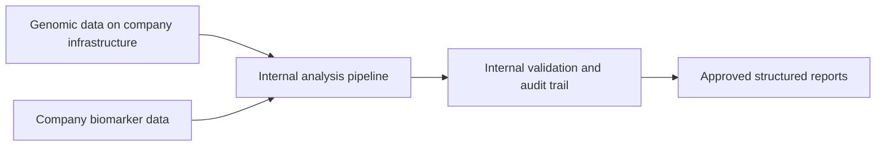
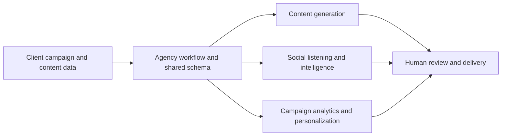

# Week 7 — Additional architecture sketches

These are short working sketches for the rubric's completeness list. The costed recommendation for the required GhentAccounting scenario is in [architecture.md](architecture.md).

## FlandersBio — Build the core internally

Competitive advantage and infrastructure restrictions drive the decision. Own the proprietary analysis workflow and evidence trail. Use replaceable infrastructure components where possible. With two ML engineers and large data volumes, cost storage, compute, auditing and operational support before committing to delivery.

Exit path: retain source data, code, run metadata and validation fixtures inside company infrastructure. Test restoring an equivalent environment and reproducing approved outputs.

## BeneluxMarketing — Connect

The agency has six disconnected tools, one developer, three languages and changing requirements. Start with a limited workflow that removes duplicate work. Keep channel-specific integrations and client data permissions explicit.

Exit path: save campaign records, client identifiers and output history in a format the agency controls. Swap one connector and verify permissions, expected fields and output quality before diverting traffic.

## MCP understanding check

MCP standardizes how compatible applications discover and call tools and receive results. A replacement can reuse a compatible tool connection, which reduces some adapter work. The protocol does not create an export right or make two models behave alike. For a one-task classifier, owning a small input and output interface may be sufficient. MCP becomes more useful if the application later needs to connect several reusable tools.

Source: [Week 7, Activity 4 and MCP brief](https://advanced-ai-in-business.vercel.app/week/7).
