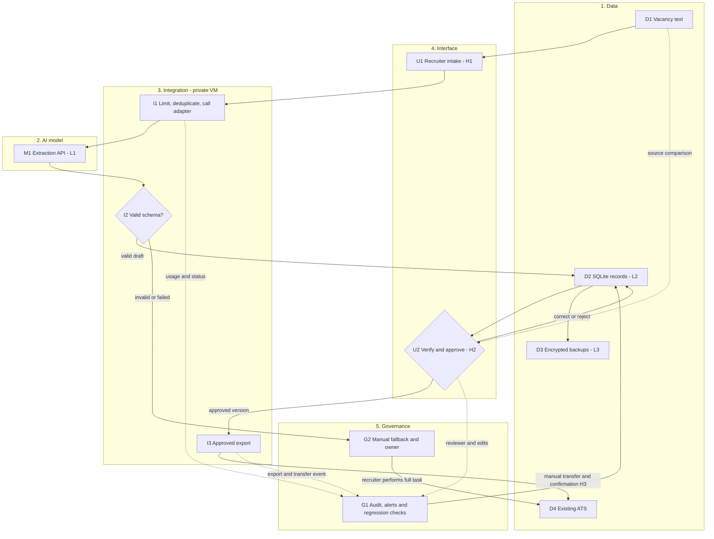

# Week 8 — Proposed recruitment integration architecture

**Student:** Ruben Naessens  
**Beat:** AI in international recruitment  
**Version:** Design A, 26 November 2026  
**Status:** AI-assisted design draft for student and practitioner review. Not implemented, deployed or approved by Worldwiders. This is a hypothetical small-agency scenario informed by Ruben's recruitment experience, not a description of Worldwiders' systems.

## 1. Job to be done and present evidence

Turn a supplied vacancy description into mandatory and preferred education, experience, professional skills and language requirements, ready for recruiter verification. This is qualification extraction, not candidate ranking or automated hiring.

**Exists:** the manual v1 prompt, recovered test texts and original results log. The log records 1/10 strict passes under its category policy.  
**Proposed:** the application, provider API integration, database, validation code, review interface, exports, monitoring and access controls. A prompt is not evidence that these components work. The proposed API model has not been tested on the ten cases; old ChatGPT results cannot establish its performance.

The first pilot uses only public or explicitly approved non-confidential vacancy text. No CVs, applicant records or automated rejection decisions. A structured vacancy intake form is the non-AI comparator.

## 2. All five layers

| Layer | Components and role | Boundary and human checkpoint | Cost IDs |
| --- | --- | --- | --- |
| 1. Data | D1: recruiter-supplied plain text; D2: SQLite staging, approved records and audit tables; D3: encrypted backup; D4: existing ATS, reached manually. Each job has a source ID/hash and timestamp. | H1: recruiter checks permission and removes unnecessary contact/confidential information before submission. No automatic scraping, email connector, PDF parser or vector database. | S1, R1, R2, H1cost |
| 2. AI model | M1: candidate OpenAI model gpt-5.4-mini-2026-03-17 through a server-side adapter; versioned prompt and fixed eight-array qualification schema. No tools or retrieval enabled. | Treat vacancy text as untrusted data. The API credential remains on the server. Provider, data-processing terms and availability require approval before live use. Model choice is provisional until evaluated. | S2, V1, R4 |
| 3. Integration | I1: Python request handler, input limits, deduplication, model adapter; I2: JSON/schema validation and exception handling; I3: approval-gated JSON/CSV export. One shared private VM runs app, worker and SQLite. | At most one retry for a transient/format error; semantic uncertainty goes to a person. Source changes create a new version. No model-generated command is executed and no ATS write credential exists. | S3, R1, R3, R4 |
| 4. Interface | U1: private Streamlit intake and U2: side-by-side source/draft review. Recruiter edits, rejects or approves. Approved output is manually copied/imported into the existing ATS workflow. | H2: recruiter compares every final field with the source, including required/preferred status and exact levels. H3: recruiter confirms the manual ATS transfer; a subsequent edit invalidates the earlier approval. | S4, S6, R1, H1cost |
| 5. Governance | G1: access roles, append-only application audit events, monthly regression checks, usage/error alerts, retention/deletion and backup-restore routine. G2: named agency owner and manual fallback procedure. | Agency lead owns acceptance; IT owns operation; recruiter owns field approval. These roles are proposed, not appointed people. Application append-only logs are not claimed to be tamper-proof. | S5, R2, R3, R5, R6, H2cost |

All software/hosting choices are proposed implementation options. The cost IDs map to the [cost model](week-08-cost-model.md). Shared infrastructure is charged once.

## 3. Architecture sketch

Every box below is proposed except the source vacancy and existing ATS. H1–H3 are human checkpoints; L1–L3 are lock-in markers.

The VM is an execution location, not a second automation platform. Log and approval tables share D2; backups are D3. No additional paid identity service, queue broker, dashboard, OCR service or ATS connector is implied.

### Data flows and record states

1. Recruiter selects the exact source and approves its use (H1). The system records the source version and creates a unique job ID.
2. I1 sends only approved vacancy text, prompt and schema to M1. Text is not granted tool or database authority.
3. I2 checks parseability, required keys, arrays and input/output limits. A syntactically correct result is not evidence of semantic correctness.
4. A valid draft enters D2 as **pending_review**; failures are **exception**, never **approved**. One transient/format retry is permitted, then manual handling.
5. U2 shows original text beside all eight arrays. Empty fields must be checked for omissions, not assumed correct. H2 records the reviewer, timestamp, edits and source/prompt/model versions.
6. Only an approved version can be exported. I3 records the export event. H3 records a separate **transfer_confirmed** event; export alone is not treated as successful ATS entry.
7. State path: **received → draft → pending_review → approved → exported → transfer_confirmed**, with **exception/rejected** branches. Edits to source or approved fields return the record to review. Repeated jobs are detected by ID/hash; user confirmation prevents duplicate manual transfers.
8. D3 stores an encrypted backup on a separate storage location. G1 records operational metadata and review events; API credentials never enter vacancy records, prompts or exports.

## 4. Deployment assumptions and controls

- One low-volume private VM, one agency, two reviewers and at most one write job at a time. SQLite is a pilot choice; concurrency, availability and higher-volume operation need a fresh sizing decision.
- Private network/VPN and staff identities are assumed to exist. The application must still enforce reviewer/admin access, session expiry, TLS and protection against forged requests. Do not expose this draft app to the public internet. If existing access cannot be reused, add a funded access-control design before deployment.
- Server-side secrets, restricted service accounts, disk encryption and credential rotation form part of S5/R4. Hosting capability and backup encryption must be checked with the selected supplier; no supplier quote has been obtained.
- Pilot retention proposal: purge raw text, drafts and exports after 30 days unless a specific authorised need is recorded; keep minimal operational events 90 days; backup rotation 30 days, so a deletion may persist in backups for up to that rotation. IT must confirm deletion propagation before use.
- No real confidential/personal data should be sent merely because the server is hosted in Europe. Provider processing, retention, terms and the agency's authorisation must be checked separately. This design does not establish compliance.
- G1 alerts on repeated errors, unreviewed backlog, duplicate IDs and usage over budget. A failed call cannot trigger an automatic candidate or ATS action.
- When API or hosting is unavailable, staff use the existing manual process. They log the bypass and reconcile the job before resuming automation. Backups support recovery, not instant failover.

## 5. Lock-in markers and exit routes

| Marker | Dependency | Exit route | Work and limitation |
| --- | --- | --- | --- |
| L1 | OpenAI API, chosen model and prompt behaviour | Keep an adapter boundary and portable eight-array JSON contract; trial another provider on the same preserved test set. | Provider replacement requires new evaluation, terms review and mapping. Proposed switching allowance: 8 developer hours + 2 reviewer hours = EUR 470; contingency, not spent or in base totals. |
| L2 | SQLite schema and Streamlit review implementation | Export source IDs, approved fields and audit events to documented JSON/CSV; keep application source under agency control. | Moving to another database/UI still requires migration and tests. Open-source components do not eliminate application lock-in. |
| L3 | VM and backup supplier | Retain deploy instructions, encrypted backup and restoration procedure; prove restore to a different host. | Networking, identity and storage permissions need rebuilding. Retaining keys securely is necessary to restore encrypted data. |

No enterprise ATS API is assumed. Adding direct ATS writes would introduce another dependency, component, approval and cost line; that would be Design B, not an unpriced promise in Design A.

## 6. Pilot gate and practitioner review

The proposed 20-case paired trial records end-to-end time including intake, all review, corrections and manual transfer. Counterbalance task order. Measure omissions, unsupported mandatory items, tier errors and final approved-output errors separately; existing strict-pass results cannot be substituted for new measurements.

Before testing, the agency owner must agree acceptance thresholds. Proposed starting gate: all exported pilot records have explicit approval, no critical wrong/missing mandatory requirement remains in the checked final records, and median total task time is lower than the manual comparator. A small pilot is not proof of long-term safety or rare-error performance.

Ask the practitioner to challenge:
1. Is the assumed 100-vacancy monthly volume realistic, including duplicates and revisions?
2. Would side-by-side review and manual ATS transfer actually fit staff work?
3. Which mistaken qualification would cause the most harm, and what field is missing?
4. Could a structured intake form solve the task more cheaply?
5. Who would own failed jobs, corrections, retention and provider changes?

**Practitioner feedback:** not yet supplied. No quotes, review meeting, revised practitioner architecture or approval is claimed. Preserve Design A, then record attributable changes in Design B after real feedback.

## 7. Evidence boundaries

This is newly prepared recruitment design evidence, not a reconstruction of what happened in class. Northwind team work is a separate logistics case and is not claimed as Ruben's recruitment implementation. The critique given to another team, practitioner extension, Signal post 8 and checkpoint updates remain separate tasks.

AI-use disclosure: ChatGPT substantially drafted the proposed architecture, controls and assumptions. Ruben must review the choices and be able to defend them. No system was built in producing this file.
